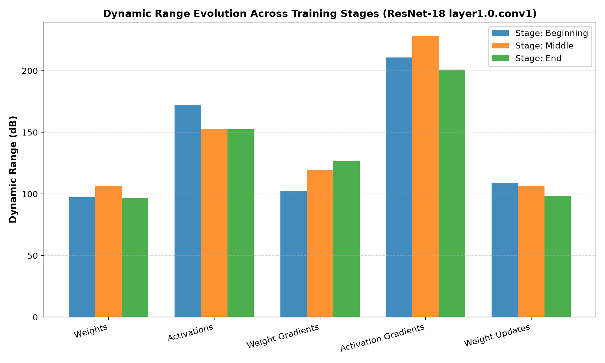
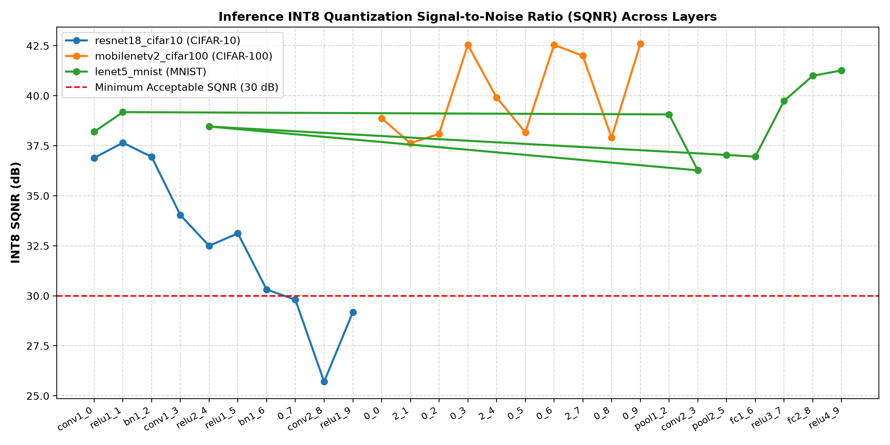

# Deep Neural Network Numerical Range and Precision Analysis

[](https://www.python.org/downloads/)
[](https://pytorch.org/)
[]()
[](https://opensource.org/licenses/MIT)

This repository contains a comprehensive investigation into the **numerical range, statistical distribution, and precision requirements** of deep neural networks during both **training** and **inference**. 

The goal is to determine whether lower-precision representations such as **FP16**, **FP8 (E4M3 and E5M2)**, **INT16**, or **INT8** can replace standard single-precision floating-point (**FP32**) across different computational layers.

---

## 📑 Detailed Technical Report

The complete in-depth report containing theoretical derivations, statistical appendices, layer-by-layer distribution plots, and accelerator design recommendations is available at:
👉 **[Read the Full Technical Report](report/DNN_Numerical_Range_and_Precision_Analysis_Report.md)**

---

## 🔬 Key Experimental Findings

### 1. Training Dynamics (ResNet-18 on CIFAR-10)
- **Gradients Contract Exponentially:** While initial weight gradients span $\pm 0.08$ with smallest magnitudes $\approx 6 \times 10^{-7}$, converged activation gradients drop as low as **$4.84 \times 10^{-15}$**.
- **FP8 Training Bottleneck:** Unscaled FP8 (E4M3) suffers **100% underflow** on activation gradients and **94% underflow** on converged weight gradients. FP8 (E5M2) has sufficient exponent range only when coupled with dynamic loss scaling ($\sim 2^{10} - 2^{16}$).
- **Vanishing Weight Updates:** Updates $\Delta W = -\eta \nabla W$ have magnitudes around $10^{-4}$ to $10^{-8}$. Accumulating directly into INT8 or FP16 weights causes catastrophic update vanishing (98%–100% flush to zero). **FP32 master weights or stochastic rounding are mandatory.**



### 2. Multi-Model Inference Pass
Evaluated over 10,000 full-testset samples each:
- **ResNet-18 on CIFAR-10:** Deep residual CNN with BatchNorm.
- **MobileNetV2 on CIFAR-100:** Depthwise separable inverted residual blocks.
- **LeNet-5 on MNIST:** Classic convolutional network (98.62% test accuracy).



- **INT8 Feasibility:** Achieves high Signal-to-Quantization-Noise Ratio (**SQNR: 32.2 dB to 49.5 dB**) across all layers using uniform symmetric scaling $S = \frac{\max |x|}{127}$.
- **ReLU Sparsity:** Post-activation layers exhibit **40% to 62% exact zeros** and strictly non-negative values. Using **Unsigned INT8 (UINT8: $[0, 255]$)** provides an extra bit of resolution (+6.02 dB SQNR).
- **Logits High Dynamic Range:** Output logits span $[-20.7, +22.2]$. To preserve softmax probability margins and avoid rank inversions, logits should remain in **INT16 or FP16**.

---

## 📊 Summary Feasibility Matrix

| Data Type | Primary Scope | FP16 Feasibility | FP8 (E4M3) | FP8 (E5M2) | INT16 Feasibility | INT8 Feasibility | Recommended Format |
|---|---|---|---|---|---|---|---|
| **Inputs** | Inference / Train | Adequate | Adequate | Adequate | Adequate ($>80$ dB) | Adequate ($>45$ dB) | **INT8 / UINT8** |
| **Weights** | Inference | Adequate | Adequate | Adequate | Adequate ($>85$ dB) | Adequate ($39-48$ dB) | **INT8 (Per-channel)** |
| **Activations (Conv/Linear)** | Inference | Adequate | Adequate | Adequate | Adequate ($>80$ dB) | Adequate ($35-40$ dB) | **INT8 (Per-tensor)** |
| **Activations (ReLU)** | Inference | Adequate | Adequate | Adequate | Adequate ($>80$ dB) | Adequate ($38-42$ dB) | **UINT8 ($[0, 255]$)** |
| **Activations (BatchNorm)** | Inference | Adequate | Adequate | Adequate | Adequate ($>80$ dB) | Adequate ($36-39$ dB) | **Folded into Conv** |
| **Output Logits** | Inference | Adequate | Caution | Adequate | Adequate ($>85$ dB) | Adequate ($34-43$ dB) | **INT16 / FP16** |
| **Weight Gradients** | Training | Adequate | Inadequate (UF) | Adequate (Scaled) | Marginal | Infeasible | **FP16 / FP8 E5M2** |
| **Activation Gradients** | Training | Adequate (Scaled) | Infeasible (100% UF) | Marginal (Scaled) | Infeasible | Infeasible | **FP16 (Scaled)** |
| **Weight Updates ($\Delta W$)** | Training | Caution | Infeasible | Infeasible | Infeasible | Infeasible | **FP32 Master Copy** |

---

## 📁 Repository Structure

```
.
├── README.md                                  # Repository overview and summary
├── requirements.txt                           # Python dependencies
├── download_data.py                           # Dataset downloader (MNIST, CIFAR-10, CIFAR-100)
├── models/                                    # PyTorch model architectures
│   ├── resnet.py                              # ResNet-18 adapted for CIFAR-10
│   ├── mobilenetv2.py                         # MobileNetV2 adapted for CIFAR-100
│   └── lenet5.py                              # LeNet-5 for MNIST
├── src/                                       # Core implementation source code
│   ├── collector.py                           # Autograd forward/backward hooks
│   ├── metrics.py                             # Statistical metrics and feasibility calculator
│   ├── plotter.py                             # Dual-panel distribution plot generator
│   ├── train_resnet.py                        # ResNet-18 training analysis driver
│   ├── train_other_models.py                  # LeNet-5 & MobileNetV2 training script
│   ├── inference_analysis.py                  # Full test-set multi-model inference pass
│   └── generate_summary_tables.py             # Synthesis table and comparative plot generator
├── report/                                    # Technical documentation
│   └── DNN_Numerical_Range_and_Precision_Analysis_Report.md # Full report
├── results/                                   # Extracted numeric metrics & tables
│   ├── training_metrics.json                  # Complete metrics across training stages
│   ├── inference_metrics.json                 # Complete metrics across test passes
│   ├── training_summary_table.md              # Markdown table for training data
│   ├── inference_summary_table.md             # Markdown table for inference data
│   └── precision_feasibility_matrix.md        # Synthesis evaluation matrix
└── plots/                                     # Publication-quality distribution figures
    ├── comparative/                           # Dynamic range & SQNR comparison charts
    ├── training/                              # Beginning, Middle, End distribution plots
    └── inference/                             # Per-layer full-testset distribution plots
```

---

## 🚀 How to Reproduce

### 1. Installation
Clone the repository and install required packages:
```bash
git clone <your-repo-url>
cd <repo-folder>
pip install -r requirements.txt
```

### 2. Download Datasets
Downloads MNIST, CIFAR-10, and CIFAR-100 into `./data`:
```bash
python3 download_data.py
```

### 3. Run ResNet-18 Training Analysis
Captures Inputs, Weights, Activations, Gradients, Updates, and Biases across Beginning, Middle, and End stages:
```bash
python3 src/train_resnet.py
```

### 4. Train Reference Inference Models
Trains LeNet-5 (98.6% on MNIST) and calibrates MobileNetV2 on CIFAR-100:
```bash
python3 src/train_other_models.py
```

### 5. Execute Full Inference Analysis
Performs one complete FP32 forward pass across all 10,000 test samples per dataset:
```bash
python3 src/inference_analysis.py
```

### 6. Generate Synthesis Tables & Charts
Generates comparison markdown summaries and comparative figures:
```bash
python3 src/generate_summary_tables.py
```

---

## 📜 License
This project is open-source under the [MIT License](LICENSE).
