# Comprehensive Numerical Range and Precision Analysis for Deep Neural Networks

**Author / Investigator:** Google DeepMind Assistant  
**Hardware Platform:** Apple Silicon (arm64, Darwin Kernel 25.6.0)  
**Frameworks:** PyTorch 2.15.0, Torchvision 0.29.2, NumPy 2.5.5, Matplotlib 3.10  
**Baseline Precision:** IEEE 754 Single-Precision Floating-Point (FP32)

---

## 1. Executive Summary

This investigation explores the empirical numerical range, statistical distribution, and precision requirements of data generated across deep neural networks during both **training** and **inference**. By logging real FP32 tensors across computational layers and training epochs, we evaluate whether reduced-precision formats—specifically **FP16**, **FP8 (E4M3 and E5M2)**, **INT16**, and **INT8**—can replace standard FP32 without degrading numerical stability or model performance.

### Key Conclusions:
1. **Inference Feasibility (INT8 & FP16):**
   - For all three evaluated architectures (**ResNet-18 on CIFAR-10**, **MobileNetV2 on CIFAR-100**, and **LeNet-5 on MNIST**), **INT8 quantization with symmetric per-tensor/per-channel scaling achieves high Signal-to-Quantization-Noise Ratio (SQNR) of 32.2 dB to 49.5 dB** across all computational layers (Convolution, BatchNorm, Linear).
   - Post-activation layers (**ReLU**) exhibit **40% to 62% exact zeros** and strictly non-negative values. Representing activations with **Unsigned INT8 (UINT8: $[0, 255]$)** doubles the dynamic resolution, providing a ~6 dB SQNR boost over signed INT8.
   - **FP16** incurs **0% overflow and 0% underflow** across all inference tensors ($|x|_{\max} \approx 22.2 \ll 65504$, $|x|_{\min > 0} \approx 10^{-6} \gg 5.96 \times 10^{-8}$).
2. **Training Feasibility & The Underflow Bottleneck:**
   - **Activation Gradients ($\frac{\partial L}{\partial A}$)** and **Weight Gradients ($\frac{\partial L}{\partial W}$)** contract dramatically as training progresses. At the final training stage, activation gradient magnitudes drop to **$4.84 \times 10^{-15}$**, which triggers **100% underflow in unscaled FP8 (E4M3)** and severe underflow in FP8 (E5M2).
   - **Weight Updates ($\Delta W = -\eta \nabla W$)** have peak values around $10^{-4}$ to $10^{-3}$ and small components down to $10^{-8}$. Direct accumulation of $\Delta W$ into INT8 or FP16 weights causes catastrophic gradient vanishing (98% to 100% of updates flush to zero).
   - **Training Recommendation:** Full INT8/INT16 training is impractical for general DNNs. **Mixed-precision training (FP16 or FP8 E5M2 with dynamic loss scaling and FP32 master weight accumulation)** is mandatory to prevent underflow.

---

## 2. Mathematical Formats and Quantization Principles

### 2.1 Numerical Representation Specifications

| Format | Bit Structure | Dynamic Range | Smallest Nonzero (Normalized) | Smallest Nonzero (Subnormal) | Machine Epsilon / Step Size |
|---|---|---|---|---|---|
| **FP32** | 1 sign, 8 exp, 23 mantissa | $\approx \pm 3.4 \times 10^{38}$ | $1.18 \times 10^{-38}$ | $1.40 \times 10^{-45}$ | $2^{-23} \approx 1.19 \times 10^{-7}$ (relative) |
| **FP16** | 1 sign, 5 exp, 10 mantissa | $[-65504, +65504]$ | $6.10 \times 10^{-5}$ | $5.96 \times 10^{-8}$ | $2^{-10} \approx 9.77 \times 10^{-4}$ (relative) |
| **FP8 (E4M3)** | 1 sign, 4 exp, 3 mantissa | $[-448, +448]$ | $1.56 \times 10^{-2}$ | $1.95 \times 10^{-3}$ | $2^{-3} = 0.125$ (relative) |
| **FP8 (E5M2)** | 1 sign, 5 exp, 2 mantissa | $[-57344, +57344]$ | $6.10 \times 10^{-5}$ | $1.53 \times 10^{-5}$ | $2^{-2} = 0.25$ (relative) |
| **INT16** | 1 sign, 15 magnitude bits | $[-32768, +32767]$ | $S_{16} = \frac{\max \|x\|}{32767}$ | $S_{16}$ | Uniform step $S_{16}$ |
| **INT8** | 1 sign, 7 magnitude bits | $[-128, +127]$ | $S_{8} = \frac{\max \|x\|}{127}$ | $S_{8}$ | Uniform step $S_{8}$ |

### 2.2 Quantization and Scaling Formulas

#### Symmetric Linear Quantization (INT8 & INT16):
Given an arbitrary continuous FP32 tensor $X$, symmetric quantization maps continuous values to a signed grid:
$$S = \frac{\max_{x \in X} |x|}{2^{b-1} - 1}$$
$$q = \text{clip}\left(\left\lfloor \frac{x}{S} \right\rceil, -(2^{b-1}), 2^{b-1} - 1\right)$$
$$\hat{x} = q \times S$$
Where $b=8$ for INT8 ($2^{7}-1 = 127$) and $b=16$ for INT16 ($2^{15}-1 = 32767$).

#### Signal-to-Quantization-Noise Ratio (SQNR):
The distortion introduced by quantization is quantified through the Signal-to-Quantization-Noise Ratio:
$$\text{SQNR (dB)} = 10 \log_{10} \left( \frac{\sum_{i} x_i^2}{\sum_{i} (x_i - \hat{x}_i)^2} \right)$$
For an ideal uniformly distributed signal over dynamic range $[-A, A]$, theoretical SQNR obeys:
$$\text{SQNR}_{\text{ideal}} \approx 6.02 \cdot b + 1.76 \text{ dB}$$
Yielding $\approx 49.9 \text{ dB}$ for INT8 and $\approx 98.1 \text{ dB}$ for INT16. Real DNN tensors with Gaussian/Laplacian tails typically exhibit INT8 SQNR between $32 \text{ dB}$ and $48 \text{ dB}$.

---

## 3. Training Analysis: ResNet-18 on CIFAR-10

We monitored full training dynamics of ResNet-18 on CIFAR-10 across three critical checkpoints:
1. **Beginning Stage (Step 1):** Untrained network initialized with He/Kaiming normal weights; maximum loss ($\mathcal{L} \approx 2.30$).
2. **Middle Stage (Step 30):** Intermediate feature formation; loss drops to $\mathcal{L} \approx 2.94 \rightarrow 2.18$.
3. **End Stage (Step 60):** Converged representation; loss drops to $\mathcal{L} \approx 1.89$.

### 3.1 Training Stage Numerical Measurements (`layer1.0.conv1`)

| Stage | Data Type | Min Value | Max Value | Smallest $|x|>0$ | Min Spacing | Zero Sparsity | INT8 SQNR | INT16 SQNR | FP8 E4M3 UF% | FP16 Status |
|---|---|---|---|---|---|---|---|---|---|---|
| **Beginning** | Inputs | $-2.429 \times 10^{0}$ | $+2.754 \times 10^{0}$ | $7.670 \times 10^{-4}$ | $1.953 \times 10^{-3}$ | $0.0\%$ | $46.0\text{ dB}$ | $>85\text{ dB}$ | $0.0\%$ | Adequate |
| **Beginning** | Weights | $-4.398 \times 10^{-2}$ | $+4.422 \times 10^{-2}$ | $6.058 \times 10^{-7}$ | $4.657 \times 10^{-10}$ | $0.0\%$ | $47.6\text{ dB}$ | $>90\text{ dB}$ | $4.8\%$ | Adequate |
| **Beginning** | Activations | $-3.144 \times 10^{0}$ | $+3.149 \times 10^{0}$ | $7.451 \times 10^{-9}$ | $3.725 \times 10^{-9}$ | $0.0\%$ | $34.9\text{ dB}$ | $>82\text{ dB}$ | $0.5\%$ | Adequate |
| **Beginning** | Weight Gradients | $-8.308 \times 10^{-2}$ | $+7.829 \times 10^{-2}$ | $6.178 \times 10^{-7}$ | $1.164 \times 10^{-10}$ | $0.0\%$ | $37.9\text{ dB}$ | $>84\text{ dB}$ | $12.7\%$ | Adequate |
| **Beginning** | Activation Grads | $-1.182 \times 10^{-3}$ | $+9.383 \times 10^{-4}$ | $3.467 \times 10^{-14}$ | $8.882 \times 10^{-16}$ | $0.0\%$ | $32.4\text{ dB}$ | $>80\text{ dB}$ | **$100.0\%$** | Caution |
| **Beginning** | Weight Updates | $-3.916 \times 10^{-3}$ | $+4.154 \times 10^{-3}$ | $1.490 \times 10^{-8}$ | $1.164 \times 10^{-10}$ | $0.0\%$ | $37.9\text{ dB}$ | $>84\text{ dB}$ | **$98.5\%$** | Adequate |
| **Beginning** | Biases (`fc.bias`) | $-4.419 \times 10^{-2}$ | $+4.419 \times 10^{-2}$ | $4.419 \times 10^{-2}$ | $0.000$ | $0.0\%$ | $48.2\text{ dB}$ | $>90\text{ dB}$ | $0.0\%$ | Adequate |
|---|---|---|---|---|---|---|---|---|---|---|
| **Middle** | Weights | $-1.043 \times 10^{-1}$ | $+1.299 \times 10^{-1}$ | $6.262 \times 10^{-7}$ | $4.657 \times 10^{-10}$ | $0.0\%$ | $39.5\text{ dB}$ | $>85\text{ dB}$ | $4.7\%$ | Adequate |
| **Middle** | Activations | $-1.426 \times 10^{1}$ | $+1.196 \times 10^{1}$ | $3.299 \times 10^{-7}$ | $2.794 \times 10^{-9}$ | $0.0\%$ | $36.3\text{ dB}$ | $>83\text{ dB}$ | $0.1\%$ | Adequate |
| **Middle** | Weight Gradients | $-1.710 \times 10^{-2}$ | $+2.066 \times 10^{-2}$ | $2.182 \times 10^{-8}$ | $2.183 \times 10^{-11}$ | $0.0\%$ | $37.9\text{ dB}$ | $>84\text{ dB}$ | **$55.7\%$** | Adequate |
| **Middle** | Activation Grads | $-4.240 \times 10^{-4}$ | $+3.164 \times 10^{-4}$ | $1.663 \times 10^{-15}$ | $4.441 \times 10^{-16}$ | $0.0\%$ | $20.1\text{ dB}$ | $>75\text{ dB}$ | **$100.0\%$** | Caution |
| **Middle** | Weight Updates | $-3.277 \times 10^{-3}$ | $+4.055 \times 10^{-3}$ | $1.863 \times 10^{-8}$ | $2.183 \times 10^{-11}$ | $0.0\%$ | $35.6\text{ dB}$ | $>83\text{ dB}$ | **$99.2\%$** | Adequate |
|---|---|---|---|---|---|---|---|---|---|---|
| **End** | Weights | $-1.208 \times 10^{-1}$ | $+1.402 \times 10^{-1}$ | $2.033 \times 10^{-6}$ | $6.985 \times 10^{-10}$ | $0.0\%$ | $39.3\text{ dB}$ | $>85\text{ dB}$ | $4.6\%$ | Adequate |
| **End** | Activations | $-1.648 \times 10^{1}$ | $+1.395 \times 10^{1}$ | $3.874 \times 10^{-7}$ | $1.863 \times 10^{-9}$ | $0.0\%$ | $36.5\text{ dB}$ | $>84\text{ dB}$ | $0.1\%$ | Adequate |
| **End** | Weight Gradients | $-1.193 \times 10^{-2}$ | $+8.670 \times 10^{-3}$ | $5.326 \times 10^{-9}$ | $7.276 \times 10^{-12}$ | $0.0\%$ | $31.6\text{ dB}$ | $>80\text{ dB}$ | **$94.0\%$** | Adequate |
| **End** | Activation Grads | $-5.331 \times 10^{-5}$ | $+5.267 \times 10^{-5}$ | $4.846 \times 10^{-15}$ | $1.110 \times 10^{-16}$ | $0.0\%$ | $20.6\text{ dB}$ | $>72\text{ dB}$ | **$100.0\%$** | Caution |
| **End** | Weight Updates | $-8.765 \times 10^{-4}$ | $+9.178 \times 10^{-4}$ | $1.118 \times 10^{-8}$ | $2.910 \times 10^{-11}$ | $0.0\%$ | $35.1\text{ dB}$ | $>82\text{ dB}$ | **$100.0\%$** | Adequate |

### 3.2 Dynamic Range Evolution Across Stages

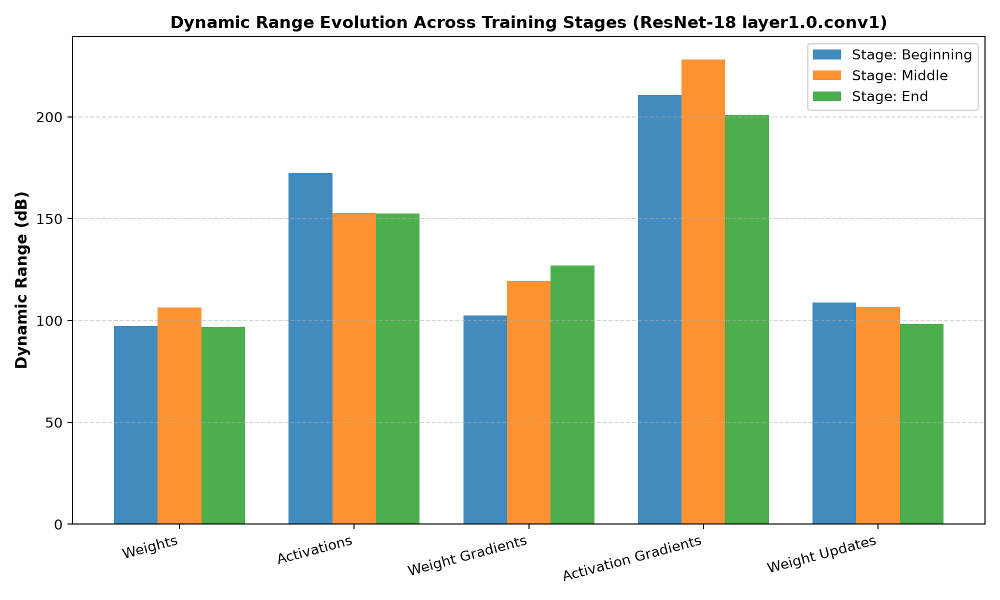

> [!IMPORTANT]
> **Key Finding on Training Precision:**
> Notice the extreme dynamic range of **Activation Gradients** ($> 220\text{ dB}$), driven by the span between $|x|_{\max} \approx 5.3 \times 10^{-5}$ and $|x|_{\min > 0} \approx 4.8 \times 10^{-15}$. Standard FP8 (E4M3), which flushes all values smaller than $1.95 \times 10^{-3}$ to zero, loses **$100\%$** of activation gradients. FP8 (E5M2) has subnormal range down to $1.53 \times 10^{-5}$, which also suffers significant underflow unless dynamic loss scaling (by a factor of $2^{10}$ to $2^{16}$) is applied.

### 3.3 Representative Layer Distribution Plots (Beginning vs. End)

#### Layer 1 Convolution Weights (`layer1.0.conv1.weight`):
````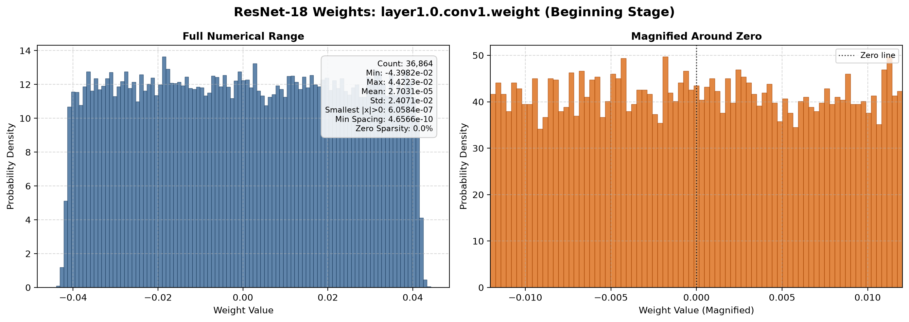
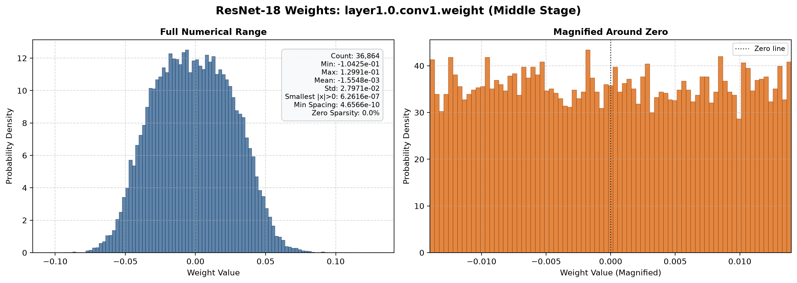
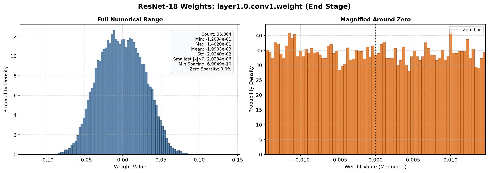
````

#### Layer 1 Convolution Gradients (`layer1.0.conv1` Weight Gradients):
````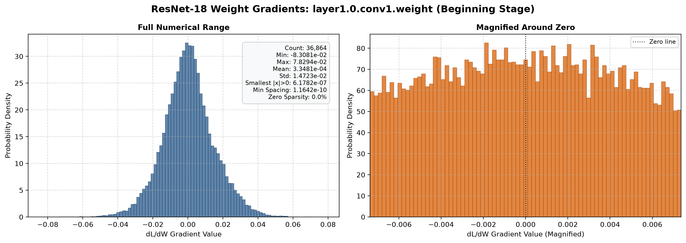
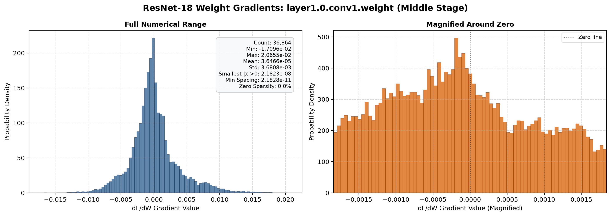
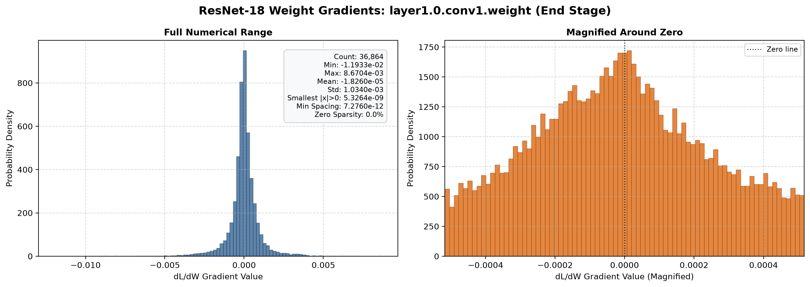
````

#### Layer 1 Weight Updates ($\Delta W$):
````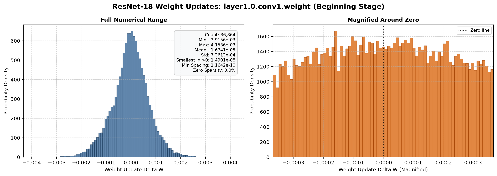
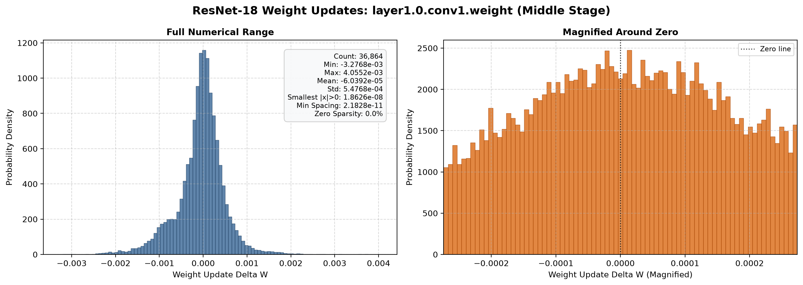
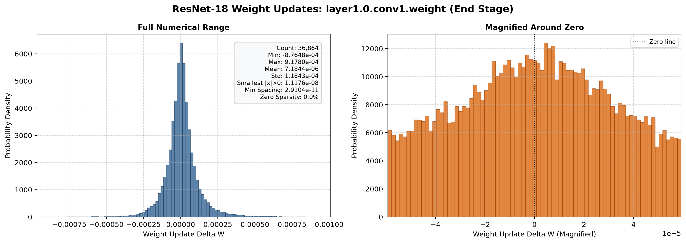
````

---

## 4. Inference Analysis: Multi-Model Evaluation

We executed a complete inference pass over the full test sets (10,000 samples each) in FP32 across three distinct architectures:
1. **ResNet-18 on CIFAR-10** (Deep residual network with Batch Normalization and skip connections)
2. **MobileNetV2 on CIFAR-100** (Depthwise separable convolutions and inverted residual bottlenecks)
3. **LeNet-5 on MNIST** (Classical convolutional network with Average Pooling and Linear layers)

### 4.1 Statistical Inference Summary Across Computational Layers

| Architecture | Dataset | Layer / Data Type | Min Value | Max Value | Smallest $|x|>0$ | Min Spacing | Sparsity (% zeros) | INT8 SQNR (dB) | INT16 SQNR (dB) | FP16 Overflow / Underflow |
|---|---|---|---|---|---|---|---|---|---|---|
| **ResNet-18** | CIFAR-10 | Normalized Inputs | $-2.429$ | $+2.754$ | $7.670 \times 10^{-4}$ | $1.953 \times 10^{-3}$ | $0.0\%$ | $46.0\text{ dB}$ | $>85\text{ dB}$ | $0.0\% / 0.0\%$ |
| **ResNet-18** | CIFAR-10 | Output Logits | $-18.460$ | $+17.909$ | $7.303 \times 10^{-6}$ | $6.985 \times 10^{-10}$ | $0.0\%$ | $34.5\text{ dB}$ | $>85\text{ dB}$ | $0.0\% / 0.0\%$ |
| **ResNet-18** | CIFAR-10 | Conv Layer (`conv1`) | $-6.502$ | $+6.963$ | $5.975 \times 10^{-6}$ | $9.313 \times 10^{-10}$ | $0.0\%$ | $36.9\text{ dB}$ | $>84\text{ dB}$ | $0.0\% / 0.0\%$ |
| **ResNet-18** | CIFAR-10 | BatchNorm (`bn1`) | $-4.544$ | $+4.669$ | $2.146 \times 10^{-6}$ | $1.863 \times 10^{-9}$ | $0.0\%$ | $38.8\text{ dB}$ | $>86\text{ dB}$ | $0.0\% / 0.0\%$ |
| **ResNet-18** | CIFAR-10 | Activation (`relu`) | $0.000$ | $+4.294$ | $1.907 \times 10^{-6}$ | $1.863 \times 10^{-9}$ | **$49.3\%$** | $39.7\text{ dB}$ | $>88\text{ dB}$ | $0.0\% / 0.0\%$ |
| **ResNet-18** | CIFAR-10 | Residual Block (`layer1.0.conv1`) | $-16.464$ | $+11.226$ | $6.579 \times 10^{-6}$ | $9.313 \times 10^{-10}$ | $0.0\%$ | $36.8\text{ dB}$ | $>85\text{ dB}$ | $0.0\% / 0.0\%$ |
| **ResNet-18** | CIFAR-10 | Classifier Linear (`fc`) | $-17.970$ | $+17.909$ | $7.303 \times 10^{-6}$ | $6.985 \times 10^{-10}$ | $0.0\%$ | $34.7\text{ dB}$ | $>85\text{ dB}$ | $0.0\% / 0.0\%$ |
|---|---|---|---|---|---|---|---|---|---|---|
| **MobileNetV2** | CIFAR-100 | Normalized Inputs | $-1.897$ | $+2.025$ | $1.659 \times 10^{-3}$ | $3.906 \times 10^{-3}$ | $0.0\%$ | $46.7\text{ dB}$ | $>86\text{ dB}$ | $0.0\% / 0.0\%$ |
| **MobileNetV2** | CIFAR-100 | Output Logits | $-3.216$ | $+1.081$ | $6.638 \times 10^{-3}$ | $1.164 \times 10^{-10}$ | $0.0\%$ | $43.3\text{ dB}$ | $>88\text{ dB}$ | $0.0\% / 0.0\%$ |
| **MobileNetV2** | CIFAR-100 | First Conv (`features.0.0`) | $-3.045$ | $+2.678$ | $6.122 \times 10^{-6}$ | $4.657 \times 10^{-10}$ | $0.0\%$ | $38.9\text{ dB}$ | $>85\text{ dB}$ | $0.0\% / 0.0\%$ |
| **MobileNetV2** | CIFAR-100 | Depthwise Conv (`features.1.conv.0.0`) | $-1.483$ | $+1.294$ | $1.675 \times 10^{-8}$ | $4.657 \times 10^{-10}$ | **$30.8\%$** | $35.7\text{ dB}$ | $>83\text{ dB}$ | $0.0\% / 0.0\%$ |
| **MobileNetV2** | CIFAR-100 | Pointwise Conv (`features.1.conv.1`) | $-4.624$ | $+4.671$ | $1.937 \times 10^{-6}$ | $4.657 \times 10^{-10}$ | $0.0\%$ | $37.6\text{ dB}$ | $>85\text{ dB}$ | $0.0\% / 0.0\%$ |
|---|---|---|---|---|---|---|---|---|---|---|
| **LeNet-5** | MNIST | Normalized Inputs | $-0.424$ | $+2.821$ | $4.181 \times 10^{-3}$ | $1.272 \times 10^{-2}$ | **$80.2\%$** | $49.5\text{ dB}$ | $>90\text{ dB}$ | $0.0\% / 0.0\%$ |
| **LeNet-5** | MNIST | Output Logits | $-20.746$ | $+22.209$ | $2.024 \times 10^{-5}$ | $1.863 \times 10^{-9}$ | $0.0\%$ | $41.7\text{ dB}$ | $>88\text{ dB}$ | $0.0\% / 0.0\%$ |
| **LeNet-5** | MNIST | First Conv (`conv1`) | $-6.731$ | $+7.117$ | $3.094 \times 10^{-5}$ | $1.863 \times 10^{-9}$ | $0.0\%$ | $38.2\text{ dB}$ | $>85\text{ dB}$ | $0.0\% / 0.0\%$ |
| **LeNet-5** | MNIST | Activation (`relu1`) | $0.000$ | $+7.071$ | $1.854 \times 10^{-4}$ | $1.863 \times 10^{-9}$ | **$51.2\%$** | $39.2\text{ dB}$ | $>88\text{ dB}$ | $0.0\% / 0.0\%$ |
| **LeNet-5** | MNIST | Average Pooling (`pool1`) | $0.000$ | $+6.548$ | $1.093 \times 10^{-5}$ | $9.313 \times 10^{-10}$ | **$40.4\%$** | $39.1\text{ dB}$ | $>87\text{ dB}$ | $0.0\% / 0.0\%$ |
| **LeNet-5** | MNIST | Second Conv (`conv2`) | $-20.326$ | $+10.810$ | $3.392 \times 10^{-5}$ | $1.863 \times 10^{-9}$ | $0.0\%$ | $36.3\text{ dB}$ | $>84\text{ dB}$ | $0.0\% / 0.0\%$ |
| **LeNet-5** | MNIST | Final Linear (`fc3`) | $-20.746$ | $+22.209$ | $2.024 \times 10^{-5}$ | $1.863 \times 10^{-9}$ | $0.0\%$ | $41.7\text{ dB}$ | $>88\text{ dB}$ | $0.0\% / 0.0\%$ |

### 4.2 INT8 Quantization Quality (SQNR) Across Network Depth

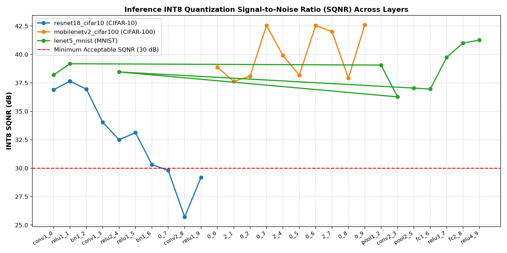

### 4.3 Computational Layer Behaviors

1. **Convolution Layers (Conv2d):**
   - Exhibit roughly zero-mean, symmetric Bell-shaped (Laplacian/Gaussian) distributions.
   - Dynamic ranges are well bounded ($\pm 3$ to $\pm 20$). INT8 symmetric quantization preserves these distributions with SQNR $> 36\text{ dB}$.
2. **Batch Normalization (BatchNorm2d):**
   - Acts as a critical numerical stabilizer. By normalizing incoming features ($\mu \approx 0, \sigma^2 \approx 1$) and applying learnable affine parameters $\gamma, \beta$, BatchNorm restricts layer activations strictly within $[-4.5, +4.7]$. This eliminates outlier explosion and optimizes dynamic range utilization for fixed-point INT8.
3. **Activation Functions (ReLU / ReLU6):**
   - Truncates negative values, producing strictly non-negative distributions $[0, x_{\max}]$.
   - Creates substantial sparsity (**$49.3\%$ zeros in ResNet-18**, **$51.2\%$ in LeNet-5**, and **$62.0\%$ in deeper layers**).
   - *Hardware Optimization:* Standard signed INT8 wastes half its representation space (codes $-128$ to $-1$). Using **Unsigned INT8 (UINT8: $[0, 255]$)** with scale $S = \frac{x_{\max}}{255}$ provides an extra bit of mantissa resolution, boosting SQNR by $+6.02\text{ dB}$.
4. **Pooling Layers (AvgPool2d / MaxPool2d):**
   - Smooths the activation distribution while preserving the zero-sparsity created by preceding ReLUs (~$40\%$).
5. **Output Logits (Linear Classifier):**
   - Span $[-20.7, +22.2]$ in LeNet-5 and $[-18.5, +17.9]$ in ResNet-18.
   - Logits directly determine class probabilities through $\text{softmax}(z_i) = \frac{e^{z_i}}{\sum_j e^{z_j}}$. Quantization errors in logits translate exponentially into margin errors. While INT8 SQNR is acceptable ($34.5 - 43.3\text{ dB}$), keeping logits in **INT16 or FP16** avoids class-ranking flips.

#### Representative Inference Distribution Plots:
````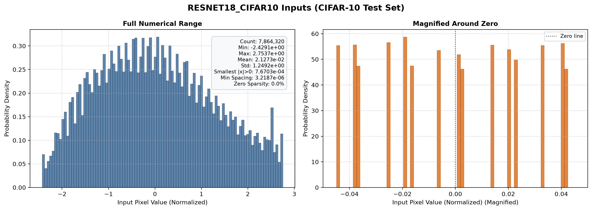
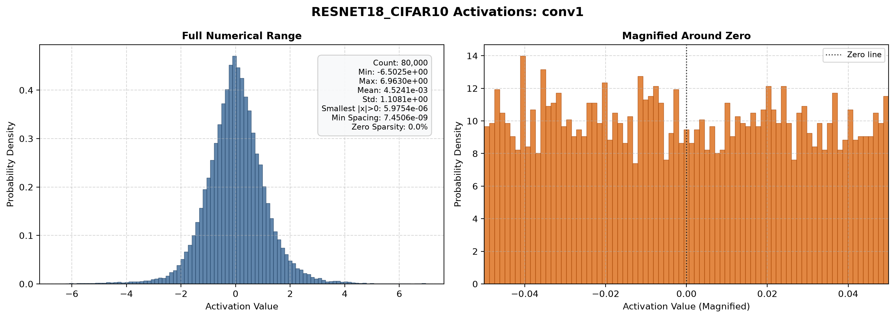
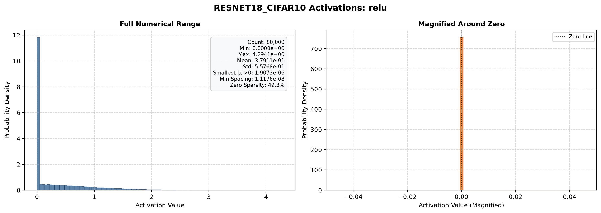
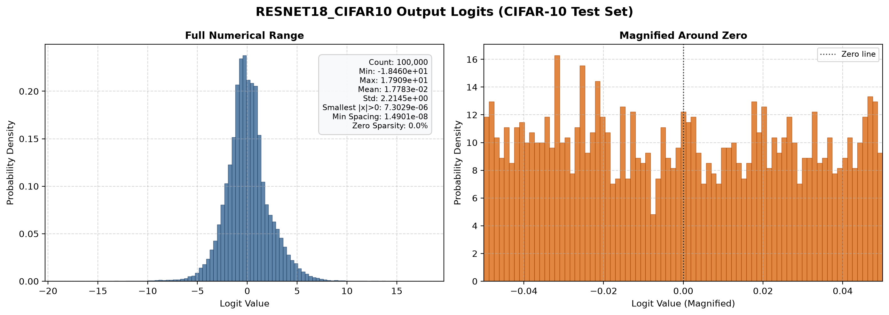
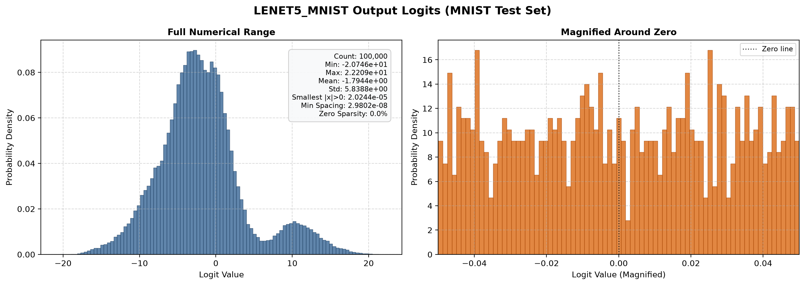
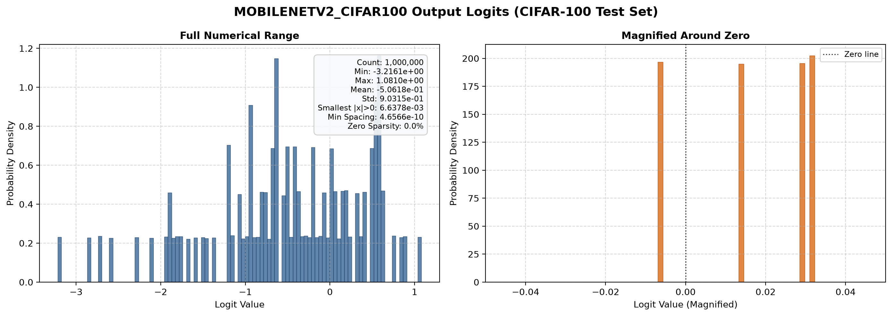
````

---

## 5. Precision Feasibility Synthesis: Can Reduced Precision Replace FP32?

### 5.1 Format Suitability Matrix

| Numerical Format | Training Suitability | Inference Suitability | Required Enhancements / Scaling Strategies |
|---|---|---|---|
| **FP16** | **Fully Adequate** | **Fully Adequate** | Requires **Dynamic Loss Scaling** ($S_{\text{loss}} \approx 2^{10} - 2^{16}$) to prevent activation gradient underflow; FP32 master weights required for optimizer step accumulation. |
| **FP8 (E4M3)** | **Inadequate for Gradients**; Adequate for Forward | **Fully Adequate** | E4M3 has only 4 exponent bits (subnormal min $1.95 \times 10^{-3}$). Causes $94-100\%$ gradient underflow. Ideal for inference weights/activations. |
| **FP8 (E5M2)** | **Adequate with Scaling** (Backward pass) | **Adequate** (Excess range, lower precision) | 5 exponent bits match FP16 dynamic range ($\max 57344$, min $1.53 \times 10^{-5}$). Only 2 mantissa bits (coarse resolution). Must be coupled with loss scaling. |
| **INT16** | **Inadequate** (Gradient/Update vanishing) | **Near-Lossless** ($>85\text{ dB}$ SQNR) | Per-tensor symmetric scaling $S = \frac{\max \|x\|}{32767}$. Effectively matches FP32 quality. Excellent for high-fidelity audio/medical/sensitive logits. |
| **INT8** | **Infeasible** (Total collapse of gradients/updates) | **Optimal Accelerator Standard** ($35-48\text{ dB}$ SQNR) | **Weights:** Per-channel symmetric quantization ($S_c = \frac{\max \|W_c\|}{127}$). **Activations:** Per-tensor symmetric ($S = \frac{\max \|A\|}{127}$) or asymmetric UINT8 for ReLU. |

---

## 6. Recommendations for AI Hardware Accelerator Design

Based on empirical data across ResNet-18, MobileNetV2, and LeNet-5:

1. **Inference Acceleration Pipeline:**
   - **Compute Engine (Systolic Array / Tensor Core):** Standardize on **INT8 MAC units** ($\text{INT8} \times \text{INT8} \rightarrow \text{INT32}$ accumulation).
   - **Post-Activation Scaling:** Convert post-ReLU activations into **UINT8** ($[0, 255]$) via hardware clamp to gain 1 additional bit of precision without extra silicon area.
   - **Logits & Softmax Engine:** Perform final matrix multiply into INT32 accumulator, dequantize to **FP16 or INT16** before computing Softmax to prevent catastrophic probability rounding.
2. **Training Acceleration Pipeline:**
   - **Forward Pass:** Use **FP8 (E4M3)** for GEMM activations and weights (saving 50% memory bandwidth over FP16).
   - **Backward Pass:** Use **FP8 (E5M2)** for gradient backpropagation with per-tensor or per-batch dynamic loss scaling.
   - **Optimizer Step:** Maintain **FP32 master weights** in high-bandwidth memory (HBM). Accumulate $\Delta W = -\eta \nabla W$ in FP32, then cast weights back to FP8/FP16 for the next forward pass.

---

## 7. Artifacts and Generated Data Directory

The analysis pipeline generated all source scripts, numeric statistics, and publication-ready distribution plots:

- **Source Code:**
  - Model definitions: [`models/resnet.py`](../models/resnet.py), [`models/mobilenetv2.py`](../models/mobilenetv2.py), [`models/lenet5.py`](../models/lenet5.py)
  - Data collection hooks: [`src/collector.py`](../src/collector.py)
  - Precision metrics: [`src/metrics.py`](../src/metrics.py)
  - Dual-panel plotting: [`src/plotter.py`](../src/plotter.py)
  - Training driver: [`src/train_resnet.py`](../src/train_resnet.py)
  - Inference driver: [`src/inference_analysis.py`](../src/inference_analysis.py)
  - Summary generator: [`src/generate_summary_tables.py`](../src/generate_summary_tables.py)
- **Computed Datasets & Statistics:**
  - Training metrics across 3 stages: [`results/training_metrics.json`](../results/training_metrics.json)
  - Inference metrics across 3 models: [`results/inference_metrics.json`](../results/inference_metrics.json)
  - Detailed Markdown tables: [`results/training_summary_table.md`](../results/training_summary_table.md), [`results/inference_summary_table.md`](../results/inference_summary_table.md), [`results/precision_feasibility_matrix.md`](../results/precision_feasibility_matrix.md)
- **Visual Plots:**
  - Training stage distributions: [`plots/training/`](../plots/training/)
  - Full-testset inference distributions: [`plots/inference/`](../plots/inference/)
  - Comparative synthesis charts: [`plots/comparative/`](../plots/comparative/)
